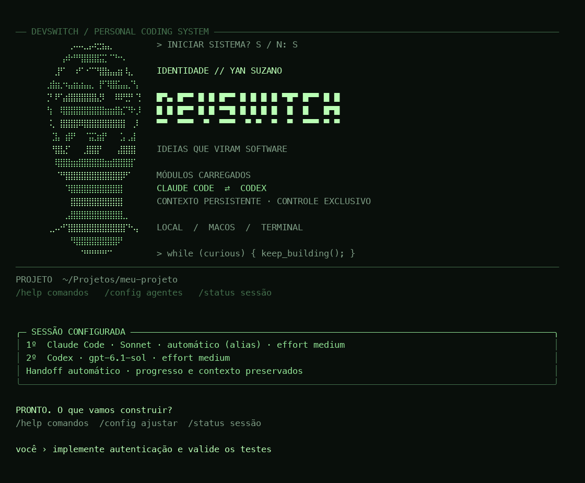
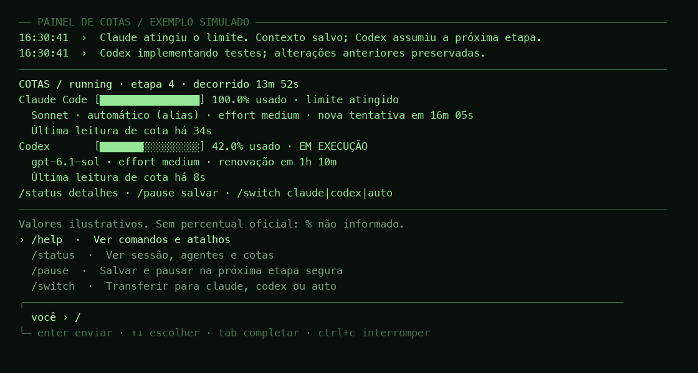

# DevSwitch

Orquestrador local para macOS, Python 3.11+, com ordem Claude Code ⇄ Codex escolhida por você. Usa os CLIs e seus logins por assinatura, sem clientes de API, serviços externos próprios ou dependências Python de terceiros.

## Usar

No macOS, instale pelo tap do projeto:

```sh
brew install yanmfs/tap/devswitch
devswitch
```

Requer Claude Code e Codex CLI instalados e autenticados nas respectivas assinaturas. `devswitch doctor` verifica os dois. Também há [instalação a partir do código-fonte](docs/DISTRIBUTION.md).

Interface verde de fósforo inspirada no GitHub do Yan Suzano, com retrato em caracteres derivado da imagem fornecida, navegação por setas/Enter, resumo dos agentes e console de comandos. Não precisa de dependências gráficas para funcionar. O comando antigo `dev-auto` permanece como alias de compatibilidade; sessões, backups e locks anteriores são preservados.



```sh
devswitch
# Pode abrir diretamente no terminal: em ~, escolha um projeto recente ou outra pasta.

cd /caminho/do/projeto
devswitch
# Usa a pasta atual. Escolha ordem, modelo e effort de cada agente; depois descreva a tarefa.

devswitch "implemente autenticação JWT e valide os testes"
devswitch --background "implemente autenticação JWT e valide os testes"
devswitch config
devswitch --configure "implemente autenticação JWT"
devswitch --first codex --claude-model sonnet --claude-effort high --codex-model gpt-6.1-sol --codex-effort xhigh "implemente autenticação JWT"
devswitch status
devswitch status --refresh
devswitch pause
devswitch resume
devswitch resume --background
devswitch switch codex
devswitch switch claude
devswitch switch auto
devswitch logs
devswitch doctor --refresh
devswitch demo
```

Também pode usar `devswitch -C /caminho/do/projeto status` ou `devswitch -C /caminho/do/projeto "tarefa"`. **Git é opcional.** Em um repositório, subpastas são normalizadas para a raiz Git. Fora de um repositório, a pasta atual é usada como projeto. O programa não executa `git init` nem reorganiza seus arquivos.

Sem Git, o controlador faz inventário e snapshots dos arquivos da pasta; Claude e Codex continuam usando o mesmo handoff. O Codex recebe a opção oficial `--skip-git-repo-check`, mantendo sandbox e permissões. O `status` informa “snapshots de arquivos · sem Git”. O modo Git continua acrescentando verificações de HEAD, branch, conflitos e índice quando esses dados existem.

`devswitch` abre de qualquer pasta do terminal. Dentro de uma pasta de trabalho, usa o diretório atual sem perguntar. Na pasta pessoal (`~`) ou em uma raiz abrangente, abre um seletor de projetos recentes ou de outra pasta; nenhum agente é iniciado antes da escolha. Não instala abertura automática do programa nem altera `.zshrc`. Para indicar uma pasta diretamente, use `devswitch -C /caminho/do/projeto`.

O menu permite escolher Claude → Codex ou Codex → Claude, modelo e effort de ambos, e então mostra um resumo seguido de `Você ›` para a tarefa. As últimas escolhas ficam salvas por projeto. `devswitch "tarefa"` usa essas escolhas diretamente; `--configure` abre o menu também nesse formato. `devswitch config` edita somente as preferências das próximas tarefas, e `devswitch config --json` permite consultá-las.

O Claude agora mostra versões explícitas: **Sonnet 5.5**, **Opus 5.5**, **Haiku 5.5** e **Fable 5.1**, com os IDs completos publicados pela Anthropic. Também mantém `sonnet`, `opus`, `haiku` e `fable` como opções separadas de **alias automático**. Escolher Sonnet 5.5 envia `--model claude-sonnet-5-5`, fixando a família/versão numerada; escolher o alias `sonnet` deixa o CLI resolver a versão. Preferências antigas não são migradas silenciosamente. A lista foi verificada em 07/11/2026 nas [páginas oficiais de modelos](https://platform.claude.com/docs/en/models/overview); a disponibilidade continua sujeita à conta e ao CLI.

O console aceita estes comandos antes de iniciar:

| Comando | Ação |
| --- | --- |
| `/help` | Ajuda dos comandos do console e terminal |
| `/config` | Abrir novamente a seleção dos agentes |
| `/first codex` | Definir quem começa |
| `/model claude opus` | Escolher modelo por agente |
| `/effort codex high` | Escolher effort por agente |
| `/models` | Consultar o catálogo local, sem inferência |
| `/status` | Ver o estado da sessão |
| `/clear` | Limpar a tela e redesenhar o cabeçalho |
| `/exit`, `/sair` | Sair sem iniciar a tarefa |

Enquanto o agente está trabalhando na janela atual, `/status`, `/help`, `/pause` e `/switch claude|codex|auto` continuam disponíveis. `/pause` (ou `/exit` durante a execução) aguarda uma etapa segura e salva o contexto; a transferência também aguarda essa etapa. Para alterar modelos em uma tarefa em andamento, pause e use `devswitch resume --configure`. Mensagens comuns digitadas durante a execução não são enviadas ao agente; use os comandos de controle. `/clear` limpa somente a tela, sem apagar logs ou estado.

Durante a execução, um painel verde fixo mostra as duas barras de **consumo**, agente ativo, modelo, effort, idade da leitura e tempo até a próxima tentativa/renovação conhecida. O painel é atualizado a cada segundo; a cota oficial do Codex é consultada no máximo uma vez por minuto, também durante etapas, em uma thread de leitura que não bloqueia o teclado. Não são dois agentes escrevendo: apenas a consulta de conta ocorre em paralelo. Terminais pequenos ou sem cores recebem resumos textuais quando o estado muda. Logs redirecionados e JSON não recebem animação.

A barra do Codex usa o maior percentual entre as janelas retornadas pelo provedor, por exemplo 5h e semanal. Não representa uma soma nem uma previsão de tokens restantes. O horário de renovação corresponde à janela relevante para o limite.

Sem um percentual oficial do Claude, a barra mostra `% não informado`. O painel nunca trata o relógio como prova de renovação: ao vencer o prazo, mostra “nova tentativa na próxima etapa segura”. Se ambos estiverem limitados, o controlador aguarda, continua consultando a cota do Codex e tenta o Claude conforme o horário oficial ou o backoff. A disponibilidade do Claude só é confirmada pela execução seguinte. Uma execução bem-sucedida não atualiza artificialmente a idade de uma medição de percentual.

Código-fonte, release e instalação por Homebrew: veja [distribuição](docs/DISTRIBUTION.md).

Ao digitar `/`, a lista de comandos aparece automaticamente no rodapé. Use ↑/↓ para escolher, Tab para completar e Enter para executar/enviar. A linha `você ›` permanece fixa abaixo das cotas enquanto os eventos aparecem acima. A lista mostra os comandos disponíveis naquele momento e sugere agentes e níveis de effort. Há edição com ←/→, Home/End, Ctrl+A/E, Backspace e Ctrl+W/U/K. Colagem com múltiplas linhas usa bracketed paste e aguarda Enter; o texto não é enviado ao agente durante o trabalho, quando somente comandos de controle são aceitos. Em modo sem cores ou terminal muito estreito, o console mantém a entrada simples.



Setas e Enter funcionam em terminais interativos com cores. O modo sem cores usa números e nomes. `NO_COLOR` e `TERM=dumb` são respeitados; `--color always` força o tema e `--no-color` desliga cores. O desenho se adapta à largura; em janelas menores o cabeçalho é compacto. `--json` mantém a saída estruturada de status, config e doctor e produz JSONL para logs, sem códigos de cor. `devswitch help` funciona mesmo fora de um projeto Git.

Em um projeto sem preferências, o menu começa sugerindo Claude → Codex, Claude `sonnet`/`medium` e Codex `gpt-6.1-sol`/`medium`. Você pode escolher outra ordem, outro modelo do catálogo instalado ou informar um ID. O catálogo local não comprova acesso a um modelo na conta; a execução continua sujeita à disponibilidade do provedor. O menu não oferece modos que delegam automaticamente a agentes paralelos.

As escolhas são passadas explicitamente como `--model` e `--effort` ao Claude e `--model`/`model_reasoning_effort` ao Codex. O `status` e o início de cada etapa mostram a configuração solicitada. Quando o Claude informa o modelo resolvido no evento oficial de início, ele também é registrado; o sistema não apresenta um valor inferido como se tivesse sido confirmado pelo CLI. A opção “Padrão do CLI/modelo” omite a flag correspondente. Restrições do provedor podem limitar o effort realmente aplicado.

Se já houver tarefa pendente, `devswitch` permite retomá-la com o contexto salvo, retomar escolhendo modelos/effort ou consultar seu estado. `devswitch resume --configure` e flags como `devswitch resume --codex-effort high` também reconfiguram uma sessão pausada sem apagar seu objetivo ou handoff. Sessões criadas na versão anterior mantêm seus padrões de CLI até você reconfigurá-las.

`pause` e `switch` persistem uma solicitação, aplicada quando a etapa atual termina. Se não houver controlador, use `resume` para aplicar a solicitação. `switch codex` ou `switch claude` fixa uma preferência; se esse agente ficar indisponível, o outro pode assumir. `switch auto` restaura a ordem escolhida no menu. Uma troca nunca antecipa uma tentativa bloqueada por cota. O agente escolhido primeiro é o principal e reassume após a renovação; isso funciona nas duas ordens.

Se aparecer `needs_login`, execute `claude auth login` e/ou `codex login` no terminal normal, escolhendo a assinatura, depois `devswitch resume`. O orquestrador não executa logout nem redefine suas autenticações.

Ctrl+C, SIGHUP e SIGTERM interrompem as ferramentas, salvam um checkpoint e deixam a sessão pausada. Após queda abrupta, o supervisor encerra os agentes; `resume` reconhece as alterações parciais. Após reiniciar o Mac, execute `resume` ou `resume --background`. Não há serviço de inicialização automática instalado.

`--background` mantém a execução independente do terminal. Os comandos de controle devem apontar para o mesmo projeto e diretório de estado (`DEVSWITCH_HOME` ou o alias `DEV_AUTO_HOME`, quando definidos). `--step-timeout 1200` é o padrão: após 20 minutos sem concluir uma etapa, o processo é encerrado e a sessão pausa para inspeção. A instrução aos agentes pede etapas de aproximadamente cinco minutos.

## Fluxo e consumo

Cada etapa recebe o objetivo original, os arquivos alterados, decisões, funcionalidades concluídas, pendências, próximos passos, problemas e resultados de testes. O agente entrega um relatório estruturado. O controlador registra um checkpoint e só então decide quem executará a próxima etapa. Etapas concluídas e decisões são acumuladas; o sucessor recebe esse histórico e deve conferir o código atual antes de agir.

**Claude:** `claude -p --output-format stream-json` emite eventos oficiais `rate_limit_event`. Quando existe `utilization`, o controlador considera 90% para preparar a troca no fim da etapa; `resetsAt` é usado quando presente. Rejeições por cota ou `system/api_retry` com `error=rate_limit` encerram aquela execução antes de passar o controle. O percentual é opcional e não foi fornecido no teste real desta instalação. Não se confunde consumo de contexto ou contagem de tokens com consumo da assinatura.

A interface interativa do Claude tem `/usage` e status line, mas não há nesta implementação uma consulta independente de consumo por JSON confiável para `-p`. O sistema não raspa a tela, não lê tokens e não chama endpoints internos. Sem `resetsAt`, tenta novamente depois de 15, 30 e até 60 minutos. Com horário oficial, aguarda o horário mais cinco segundos. O relógio apenas permite tentar; **a renovação só é confirmada quando a execução real volta a funcionar**. Durante trabalho do Codex, a próxima etapa segura verifica se essa tentativa já é permitida. Não há probes de inferência concorrentes desperdiçando cota do Claude.

**Codex:** o app-server local usa JSON-RPC oficial `initialize`, `account/read` e `account/rateLimits/read`. O controlador consulta suas janelas antes das etapas e, durante as etapas ou espera, em intervalos de 60 segundos. Uma janela em 100% impede novas etapas até uma nova consulta confirmar capacidade, ou chegar o momento de tentar novamente. Erros de limite de `codex exec --json` também são detectados. `status --refresh` consulta as cotas sem iniciar uma tarefa de inferência.

Se ambos estiverem sem cota, o controlador permanece em `waiting_quota`, sem agente escritor. Ele não compra créditos, não resgata créditos de renovação, não altera contas e não contorna limites.

As variáveis de API Anthropic/OpenAI e substituições de provedor são removidas do ambiente dos filhos. O Codex é fixado ao login ChatGPT e provedor OpenAI; Claude precisa informar `authMethod=claude.ai`. Não há fallback para chave de API. A seleção de modelo/effort não altera autenticação, provedor ou faturamento. Preferências de cobrança/uso extra já habilitadas na conta continuam sob controle do provedor: não há uma chave pública universal para desabilitá-las por invocação. Para uso estritamente restrito à cota incluída, mantenha uso extra e recarga automática desativados nos serviços.

## Integridade, permissões e recuperação

- Com Git, `flock` exclusivo em `<git-common-dir>/dev-auto.lock` mantém compatibilidade com a versão anterior e protege worktrees do mesmo repositório. Sem Git, o lock fica fora do projeto em `~/.local/state/devswitch-locks/`. Locks compartilhados nos ancestrais e exclusivos na raiz impedem que pastas sobrepostas (pai/filha) executem agentes simultaneamente, inclusive misturando projetos com e sem Git. Pastas irmãs independentes podem trabalhar separadamente. Todos os descritores são herdados pelo supervisor; a proteção independe de `DEVSWITCH_HOME`/`DEV_AUTO_HOME`.
- Um supervisor herda o lock e acompanha um pipe de vida do controlador. Mesmo após SIGKILL do controlador, ele encerra o grupo de processos antes de liberar o lock. No macOS, libproc também acompanha descendentes que criam sessões próprias; a identidade do processo evita matar um PID reutilizado. Se uma ferramenta não encerrar, a transferência é bloqueada.
- Estado gravado por arquivo temporário + fsync + rename. Atualizações do usuário entram numa fila de arquivos independentes. Estado inválido é recusado, sem sobrescrita.
- Inventário antes/depois de cada etapa. Quando há Git, conflitos e submódulos causam parada para inspeção; mudanças de HEAD/branch também pausam. Remoção de arquivo existente pausa em ambos os modos. Não há init, stash, reset, clean, checkout, commit ou push automático.
- Cópias do conteúdo de todos os arquivos rastreados e não rastreados **não ignorados** pelo Git. O índice também é copiado para preservar a versão staged. Os arquivos originais e o índice permanecem intactos. Ignorados não rastreados (dependências, builds e `.env` normalmente) não entram no backup; os agentes são instruídos a não alterar segredos ou arquivos fora do escopo.
- Sem Git, o inventário usa a árvore de arquivos, sem seguir links de diretórios. Exclui dependências/caches conhecidos (`node_modules`, `.venv`, `venv`, `__pycache__`, `.cache`, `.pytest_cache`, `.mypy_cache`, `.ruff_cache`, `.next`, `.nuxt`), metadados de versionadores e diretórios de credenciais (`.ssh`, `.aws`, `.codex`, `.claude`). O estado interno do controlador também fica fora do inventário. Pode adicionar `.devswitchignore` com padrões glob por caminho ou nome, um por linha; linhas iniciadas por `#` são comentários. Não há suporte a negação `!` ou à sintaxe completa de `.gitignore` nesse arquivo.
- Claude usa modo `--restricted`, ferramentas explícitas e MCP vazio. Codex usa sandbox `workspace-write`, rede das ferramentas bloqueada e não aprova elevações. Configurações de usuário não são modificadas. Instruções do projeto são lidas no contexto da tarefa.
- Ambos recebem um hook oficial `PreToolUse`: shell aceita leitura e uma lista conservadora de comandos de teste/build. Comandos destrutivos, instalações, deploy, scripts arbitrários, redirecionamentos, substituições de shell, processos em background, leitura de credenciais e exclusão por patch são recusados. Uma operação necessária fora da política exige intervenção humana; o agente deve indicar `blocked=true`, e a sessão fica em `needs_attention`.
- O Codex exige confiança explícita para executar hooks. A invocação usa `--dangerously-bypass-hook-trust` apenas para ativar o hook local fornecido pelo projeto; sandbox e política de aprovações continuam ativos. Antes disso, o controlador verifica e recusa hooks adicionais e configurações locais com plugins/MCP, em vez de autorizar seus scripts. Não muda confiança persistida ou arquivos globais.
- Hooks são proteções adicionais, não um isolamento absoluto: os próprios CLIs têm exceções de cobertura e falhas de hooks podem não bloquear ferramentas. Testes/builds executam código do projeto. Use somente repositórios confiáveis; o lock não controla editores ou CLIs iniciados separadamente. Isso não é uma sandbox para código hostil.

Estado padrão: `~/.local/state/dev-auto/projects/<id>/`, mantido para compatibilidade com a instalação anterior. Pode escolher outro diretório com `DEVSWITCH_HOME`; `DEV_AUTO_HOME` continua aceito. Cada diretório é privado (0700); os dados são 0600. O nome interno do lock Git permanece `dev-auto.lock` para impedir concorrência com processos da versão anterior.

Arquivos relevantes:

| Arquivo/pasta | Conteúdo |
| --- | --- |
| `state.json` | Objetivo, estado do ciclo, agente, cotas e progresso |
| `preferences.json` | Ordem, modelo e effort escolhidos para próximas tarefas deste projeto |
| `workspace.json` | Caminho e última abertura do projeto, usados pelo seletor de recentes |
| `handoff.json`, `HANDOFF.md` | Contexto compartilhado, exportado automaticamente |
| `events.jsonl` | Histórico de etapas, trocas, erros e encerramento |
| `tool-audit.jsonl` | Somente nome canônico da ferramenta, agente e permitir/negar |
| `controller.log` | Resumos do controlador em segundo plano |
| `checkpoints/<id>/manifest.json` | Caminhos, modos e hashes de arquivos |
| `checkpoints/<id>/index.backup` | Índice Git original naquele checkpoint |
| `blobs/<sha256>` | Conteúdo original de cada versão preservada |
| `history/` | Estado de tarefas anteriores concluídas |

Para recuperar um arquivo, localize seu hash no manifesto e copie o blob para **outro caminho** antes de comparar/restaurar. Não há restauração automática que sobrescreva seu trabalho. O backup pode conter dados privados presentes em arquivos do projeto; não publique a pasta de estado. Não há limpeza automática de backups.

Não são salvos stdout/stderr brutos de ferramentas, prompts de autenticação, tokens, cookies ou respostas de login. A coleta de autenticação e cotas usa campos permitidos. Relatórios/resumos têm remoção adicional de padrões de segredos; não inclua credenciais no objetivo ou peça que agentes as imprimam. Os próprios CLIs podem manter seus históricos habituais fora do devswitch.

## Estados e conclusão

`starting` → `ready` → `running` → `ready`, `waiting_quota`, `paused`, `needs_login`, `needs_attention` ou `completed`.

A conclusão exige resposta estruturada válida, sucesso do CLI, `done=true`, nenhuma pendência e relato de testes. O controlador não conhece antecipadamente o teste correto de todo projeto: essa evidência é relatada pelo agente; não é uma prova independente de que um requisito arbitrário foi atendido. Relatórios inválidos e erros repetidos pausam após três ocorrências. Quatro etapas sem alteração de arquivo nem novo trabalho concluído também pausam. Retomar uma tarefa concluída não a executa novamente. Criar nova tarefa enquanto existe outra pendente é recusado.

## Instalação e testes

```sh
python3 install.py
./.venv/bin/python -m unittest discover -s tests -v
devswitch demo
```

O instalador usa somente `venv` e a biblioteca padrão. Instala um `.pth` no ambiente isolado e um launcher em `~/.local/bin`; não instala pacotes globais nem altera `.zshrc`. `pyproject.toml` também descreve o pacote, mas a instalação local não exige baixar build tools.

Os testes de limites, renovação e interrupção são **simulados** com executáveis locais, usando o controlador, pipes, processos, locks e snapshots reais. `devswitch demo` cria um projeto temporário, demonstra Claude → Codex → Claude e informa o caminho dos artefatos. Nenhum provedor é chamado nessa demonstração.

`scripts/real_smoke.py` usa **inferência real das assinaturas** em projeto temporário: Claude cria uma função, Codex recebe o contexto, escreve e executa um unittest e preserva um arquivo preexistente. Também verifica a negação por hook de `printf`, comando inofensivo escolhido deliberadamente fora da política. Não roda na suíte padrão. Reexecutar consome uma pequena quantidade de cota.

`scripts/ui_demo.py` abre a interface interativa completa com provedores simulados em uma pasta temporária. Permite testar menus, modelos, effort, tarefa e início pelo agente escolhido sem consumir cota.

Consulte [testes e limites da validação](docs/TESTING.md) e [interfaces verificadas](docs/INTERFACES.md). Logs e evidências locais de contas não fazem parte do repositório público.
